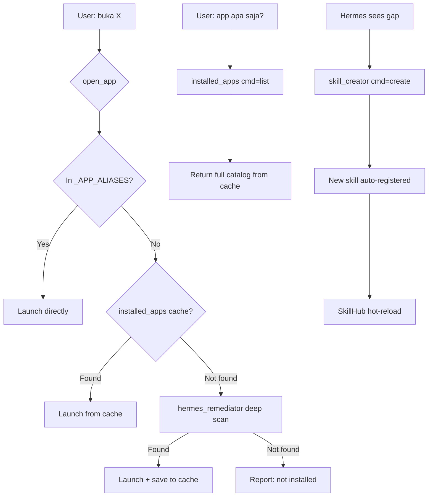

# Plan: App Discovery + Hermes Self-Improvement

## Problem Statement

Neira currently has two limitations:

1. **Limited app knowledge** — [`_APP_ALIASES`](Mark-LIV-main/skills/admin/open_app.py:25) contains only ~55 hardcoded app names. When the user asks to open an app not in this list, Neira falls through to [`hermes_remediator.remediate_app_launch()`](Mark-LIV-main/core/hermes_remediator.py:223) which does a deep scan every time (slow, no persistent catalog).

2. **No self-improvement loop** — Hermes can execute actions and save learned fixes, but cannot autonomously create new skills via [`skill_creator`](Mark-LIV-main/skills/admin/skill_creator.py:230) when it discovers capability gaps.

## Architecture Overview



## Existing Infrastructure to Reuse

| Component | Location | What it does | Reuse plan |
|-----------|----------|-------------|------------|
| Start Menu scan | [`find_all_start_menu_shortcuts()`](Mark-LIV-main/core/hermes_remediator.py:91) | Globs `*.lnk` from ProgramData + AppData Start Menu | Import directly |
| Deep scan | [`deep_scan_app_locations()`](Mark-LIV-main/core/hermes_remediator.py:108) | Registry App Paths + PATH + Program Files patterns | Import directly |
| Learned fixes | [`load_learned_fixes()`](Mark-LIV-main/core/hermes_remediator.py:48) | JSON persistence of discovered app paths | Merge into cache |
| Launch helper | [`launch_target_path()`](Mark-LIV-main/core/hermes_remediator.py:200) | ShellExecuteW with fallbacks | Import for launch |
| Skill creation | [`skill_creator()`](Mark-LIV-main/skills/admin/skill_creator.py:230) | Create/list/delete skills at runtime | Hermes calls via executor |
| SkillHub register | [`register_new_skill()`](Mark-LIV-main/core/skill_hub.py:321) | Write .py + hot-reload | Already wired in executor |
| Hermes executor | [`execute_hermes_actions()`](Mark-LIV-main/core/hermes_executor.py:467) | Dispatches action dicts from Hermes LLM | Add new action types |

## Detailed Steps

### Step 1: Create `installed_apps` skill

**File**: `skills/admin/installed_apps.py`

**Commands**: `list` | `search` | `refresh` | `launch`

**Design**:
- On first call or `refresh`, scan ALL installed apps using the existing [`find_all_start_menu_shortcuts()`](Mark-LIV-main/core/hermes_remediator.py:91) + [`deep_scan_app_locations()`](Mark-LIV-main/core/hermes_remediator.py:108) + registry Uninstall keys
- Cache results to `shared/memory/installed_apps_cache.json` with timestamp
- Auto-refresh if cache is older than 24 hours
- `list` — return all discovered apps grouped by source
- `search` — fuzzy match by name substring
- `launch` — find app in cache, launch via [`launch_target_path()`](Mark-LIV-main/core/hermes_remediator.py:200)

**TOOL dict**:
```python
TOOL = {
    "name": "installed_apps",
    "description": "Discover, list, search, and launch ALL installed applications on this computer — not limited to the hardcoded alias list.",
    "parameters": {
        "type": "OBJECT",
        "properties": {
            "cmd": {"type": "STRING", "description": "list | search | refresh | launch"},
            "query": {"type": "STRING", "description": "App name to search or launch"},
        },
        "required": ["cmd"],
    },
    "handler": installed_apps,
}
```

**Data sources** (Windows-specific):
1. Start Menu shortcuts (`*.lnk`) — richest source, covers most GUI apps
2. Registry `App Paths` — covers apps registered for shell execution
3. Registry `Uninstall` keys — covers everything with Add/Remove Programs entry
4. `PATH` executables — covers CLI tools and portable apps
5. Merge with existing [`_APP_ALIASES`](Mark-LIV-main/skills/admin/open_app.py:25) for completeness

### Step 2: Enhance `open_app.py` with `installed_apps` fallback

**File**: [`skills/admin/open_app.py`](Mark-LIV-main/skills/admin/open_app.py)

**Change**: In [`open_app()`](Mark-LIV-main/skills/admin/open_app.py:347), after `_APP_ALIASES` lookup fails and before calling `hermes_remediator`, try `installed_apps` cache:

```
Flow: _APP_ALIASES → _try_focus_existing → launcher(normalized) → installed_apps(search+launch) → hermes_remediator
```

This is a lightweight cache lookup (no scanning), so it adds negligible latency. Only if the cache also misses do we fall through to the expensive `hermes_remediator` deep scan.

### Step 3: Wire Hermes self-improvement via `skill_creator`

**File**: [`core/hermes_executor.py`](Mark-LIV-main/core/hermes_executor.py)

**Changes**:
1. Add `"use_skill_creator"` action type in [`execute_hermes_actions()`](Mark-LIV-main/core/hermes_executor.py:467) that calls [`skill_creator()`](Mark-LIV-main/skills/admin/skill_creator.py:230) directly
2. This lets Hermes emit action blocks like:
   ```json
   {
     "action": "use_skill_creator",
     "cmd": "create",
     "name": "open_photoshop",
     "code": "... TOOL dict + handler code ..."
   }
   ```

**File**: [`router/hermes_connector.py`](Mark-LIV-main/router/hermes_connector.py)

**Changes**:
- In the system prompt for Hermes (inside [`process_heavy_task()`](Mark-LIV-main/router/hermes_connector.py:52)), add awareness that `skill_creator` exists and can be used to create new skills when a capability gap is identified
- Add instruction: "If you discover an app or capability that Neira doesn't have a skill for, create one using `use_skill_creator` action"

### Step 4: Update prompt routing

**File**: [`core/prompt.txt`](Mark-LIV-main/core/prompt.txt)

**Changes** at line 26-34 (TOOL-FIRST rules):
- Add: `- Cari/list semua aplikasi terinstal → installed_apps`
- Add: `- Buat skill baru saat percakapan → skill_creator`

This ensures the surface layer (Gemini Live) knows to route "app apa saja yang terinstal?" directly to `installed_apps` instead of `deep_think`.

### Step 5: Write test

**File**: `scratch/test_installed_apps.py`

**Sections**:
1. Cache file creation + JSON validity
2. `list` command returns non-empty results
3. `search` finds known apps (e.g., "chrome", "notepad")
4. `refresh` rebuilds cache
5. `launch` for a known-safe app (e.g., notepad)
6. `open_app` fallback integration — verify an app NOT in `_APP_ALIASES` but in Start Menu can be opened
7. TOOL dict + SkillHub discovery check

## Risk Mitigation

| Risk | Mitigation |
|------|-----------|
| Start Menu scan slow on first run | Cache to JSON; auto-refresh only every 24h |
| `.lnk` shortcut resolution needs COM | Use `os.path.basename()` on `.lnk` path for display name; actual launch via `ShellExecuteW` on the `.lnk` file directly |
| Hermes creates broken skills | `skill_creator` already validates AST + compile before writing |
| Cache stale after app install/uninstall | `refresh` command + 24h auto-expiry |
| Duplicate entries from multiple sources | Deduplicate by normalized app name |

## Files Modified/Created

| Action | File |
|--------|------|
| **CREATE** | `skills/admin/installed_apps.py` |
| **MODIFY** | `skills/admin/open_app.py` (add fallback) |
| **MODIFY** | `core/hermes_executor.py` (add `use_skill_creator` action) |
| **MODIFY** | `router/hermes_connector.py` (add skill_creator awareness to Hermes prompt) |
| **MODIFY** | `core/prompt.txt` (add routing rules) |
| **CREATE** | `scratch/test_installed_apps.py` |
